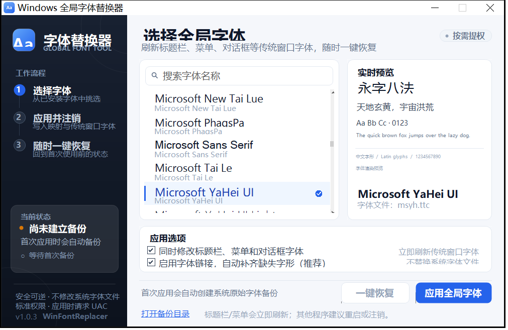
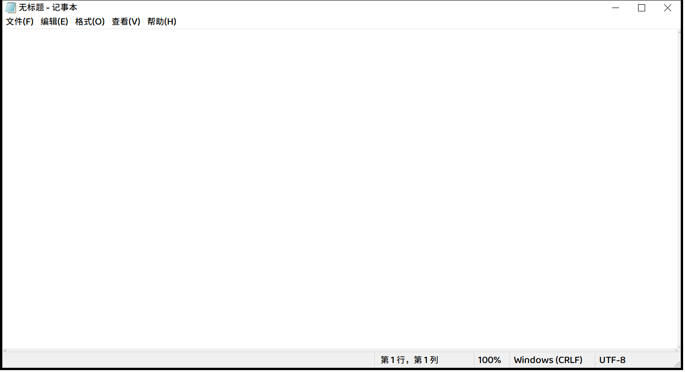
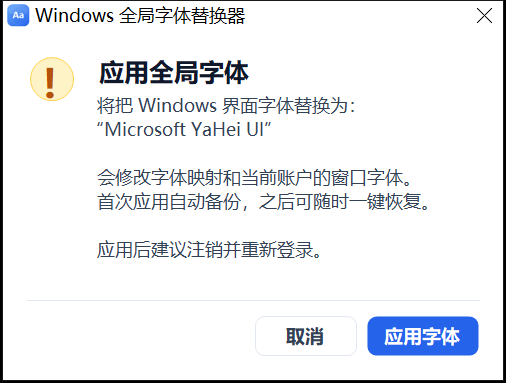

# Windows 全局字体替换器

一个安全、可逆的 Windows 字体替换小工具。选择任意已安装字体，一键应用到系统界面与传统窗口；首次应用自动保存原始设置，随时可以一键恢复。

> 仓库地址：<https://github.com/senseiri/win-font-replacer>

## 下载

- [GitHub Releases](https://github.com/senseiri/win-font-replacer/releases) 下载最新的 `WinFontReplacer-vX.Y.Z.zip`
- 或克隆源码后运行 `build.ps1` 自行编译



应用后新打开的传统 Win32 程序（记事本）标题栏与菜单效果：



## 功能特点

- **字体选择**：读取系统已安装字体，支持搜索，并用目标字体实时预览中文、英文和数字。
- **字体回退映射**：为 `Segoe UI`、`Microsoft YaHei UI`、`Microsoft YaHei`、`MS Shell Dlg`、`MS Shell Dlg 2` 写入替换/回退映射。
- **传统窗口字体**：修改标题栏、菜单、消息框、状态栏、小标题栏、图标文字等 LOGFONT，并按系统 DPI 自动选择合适字号后立即刷新。
- **DPI 自适应**：根据系统 DPI 计算字号（96 DPI 用 -12，144 DPI 用 -18），避免替换后字体变小。
- **字体链接回退**：可选把目标字体加入 `FontLink\SystemLink`，补充某些程序请求系统字体时缺失的字形。
- **一键恢复**：恢复到首次使用本工具前的状态，不需要卸载字体或手动改注册表。
- **自动回滚**：应用或恢复过程中任何一步失败，会自动写回操作前的快照。
- **按需提权**：浏览字体不需要管理员权限，只有点击“应用”或“恢复”时才请求 UAC。
- **本地运行**：不联网、不安装服务、不下载字体、不收集数据。

## 系统要求

- Windows 10 / Windows 11（64 位）
- .NET Framework 4.8（Windows 10 1903 及以上通常已自带）
- 点击应用/恢复时需要管理员权限

## 快速使用

1. 解压后双击 `WinFontReplacer.exe`，无需安装。
2. 在左侧列表选择字体，右侧会实时预览。
3. 按需勾选：
   - **同时修改标题栏、菜单和对话框字体**：推荐保持勾选。
   - **启用字体链接，自动补齐缺失字形**：推荐保持勾选。
4. 点击 **应用全局字体**，在 UAC 窗口中确认。
5. 标题栏、菜单、对话框、状态栏和桌面图标文字会立即刷新；其他已经打开的程序建议重启，或注销后重新登录。
6. 想还原时点击 **一键恢复**，确认后即可恢复原始设置。



## 它到底改了什么

本工具只修改注册表，**不会替换或删除 `C:\Windows\Fonts` 下的任何字体文件**。

| 注册表位置 | 修改内容 |
| --- | --- |
| `HKLM\SOFTWARE\Microsoft\Windows NT\CurrentVersion\FontSubstitutes` | 为 `Segoe UI`、`Microsoft YaHei UI`、`Microsoft YaHei`、`MS Shell Dlg`、`MS Shell Dlg 2` 写入替换/回退映射 |
| `HKLM\SOFTWARE\Microsoft\Windows NT\CurrentVersion\FontLink\SystemLink` | 把目标字体的文件与字体名加入 `Segoe UI`、`Microsoft YaHei UI`、`MS Shell Dlg` 的字体链接列表首位 |
| `HKCU\Control Panel\Desktop\WindowMetrics` | 修改 `CaptionFont`、`MenuFont`、`MessageFont`、`StatusFont`、`SmCaptionFont`、`IconFont` 六个 LOGFONT 的字体名 |

写入完成后程序会调用 `SystemParametersInfo(SPI_SETNONCLIENTMETRICS)` 和 `SPI_SETICONMETRICS` 立即刷新传统窗口字体，并广播 `WM_SETTINGCHANGE`。字号按系统 DPI 计算：96 DPI 为 `-12`，144 DPI 为 `-18`，因此不会因为写死字号而变小。

> 注意：Windows 对**已经安装**的字体通常不会用 `FontSubstitutes` 强行覆盖，因此真正可见的变化主要来自 `WindowMetrics`（标题栏、菜单、对话框等）以及字体链接回退。开始菜单、设置等 DirectWrite 界面仍可能使用系统内置字体。

### 备份与恢复机制

程序优先把数据放在 **exe 同目录的 `WinFontReplacerData` 文件夹**（绿色便携）。如果该目录不可写，会自动改用：

1. `%LOCALAPPDATA%\WinFontReplacer`
2. 如果检测到旧版备份 `C:\ProgramData\WinFontReplacer\baseline.xml`，继续使用旧位置
3. 最后回退到 `%TEMP%\WinFontReplacer`

首次点击“应用”时，程序会在数据目录中建立基线备份：

```text
<数据目录>\
├─ baseline.xml                 # 首次使用前的原始设置（一键恢复使用）
├─ backups\
│  ├─ before-apply-*.xml        # 每次应用前的快照
│  └─ before-restore-*.xml      # 每次恢复前的快照
├─ logs\
│  └─ operation-*.log           # 操作日志
├─ emergency-fontsubstitutes.reg
├─ emergency-fontlink.reg
└─ emergency-windowmetrics.reg
```

- **一键恢复**读取 `baseline.xml`，按“值”精确恢复；如果某个值原本不存在，会把它删除。
- 应用/恢复中途出错时，程序会立即用操作前的快照自动回滚，并在日志中记录原因。
- `emergency-*.reg` 是额外的保险：双击导入可以把对应注册表项整体恢复到首次使用前的状态。它不会删除后来新增的值，因此优先使用程序内的“一键恢复”。
- 程序使用全局互斥量，避免两个字体操作同时执行。

## 适用范围与限制（请阅读）

这是一个**注册表 + 系统参数级**的字体替换工具，不是系统字体文件打补丁工具：

- **会立即生效**：新打开的 Win32/GDI 程序、传统标题栏、菜单、消息框、状态栏、对话框、桌面图标文字。
- **可能不生效**：Windows 10/11 的开始菜单、设置、部分 UWP 应用和 DirectWrite 界面会直接加载 Segoe UI / Segoe UI Variable，不遵守传统窗口字体设置。
- `FontSubstitutes` 对已经安装的字体通常不会强行覆盖，只作为缺失字体时的回退；不要把它当作“全局替换”的唯一依据。
- 某些程序会缓存字体；应用后请重启对应程序，或注销后重新登录。
- `HKCU\Control Panel\Desktop\WindowMetrics` 是**当前用户**的设置；`HKLM` 下的字体链接/映射是**所有用户**的。
- 如果 UAC 提权时输入了**另一个管理员账户**的凭据，当前用户的窗口字体可能被写到那个管理员账户下。请从需要修改的账户运行，并使用该账户的管理员凭据。
- 若要实现 100% 替换所有 DirectWrite 界面，需要替换受保护的系统字体文件；这有导致界面异常甚至无法正常登录的风险，本工具**故意不做**。

如果你需要的是“所有界面绝对统一”的深度替换，请先备份系统并了解相关风险，再考虑专门的字体文件补丁方案。

## 常见问题

**应用后字体没有变化？**

先注销并重新登录。部分程序需要完全退出再打开；Windows 11 的部分系统界面可能不受注册表映射影响，见上面的限制说明。

**点击应用没有弹出 UAC？**

如果当前程序已经以管理员身份运行，会直接执行；否则 Windows 会弹出 UAC。若取消了 UAC，不会做任何修改。

**Windows SmartScreen 提示未知发布者？**

程序没有代码签名，这是正常提示。确认文件来源可信后，可选择“更多信息 → 仍要运行”。一些安全软件也可能对注册表字体修改报警。

**如何完全卸载？**

先点击“一键恢复”，确认恢复成功后，删除程序旁（或 `%LOCALAPPDATA%\WinFontReplacer`、旧版 `C:\ProgramData\WinFontReplacer`）的数据文件夹即可。程序本身是绿色免安装的，删除 exe 即可。

**恢复失败怎么办？**

查看数据目录下 `logs` 中最近的日志；也可以导入 `emergency-*.reg` 作为应急恢复。若界面已经异常，可在安全模式下导入这些 `.reg` 文件。

**字体列表里没有想要的字体？**

请先通过 Windows 设置安装该字体，然后重新打开本工具。

## 从源码构建

需要 .NET Framework 4.x 自带的 `csc.exe`（Windows 10/11 默认存在）。

```powershell
powershell -NoProfile -ExecutionPolicy Bypass -File .\build.ps1
```

输出：

```text
dist\WinFontReplacer.exe
```

运行自检（不会修改系统字体设置）：

```powershell
.\dist\WinFontReplacer.exe --self-test .\selftest-result.txt
```

查看自检结果：

```powershell
Get-Content .\selftest-result.txt -Encoding UTF8
```

### 源码结构

```text
src\
├─ Program.cs              # 入口、UAC 子进程、单实例
├─ MainForm.cs             # 主界面
├─ Theme.cs                # 配色、卡片、按钮、搜索框
├─ SidebarPanel.cs         # 左侧状态栏
├─ PreviewPanel.cs         # 字体预览
├─ FontCatalog.cs          # 已安装字体枚举
├─ FontFileIndex.cs        # 字体文件与字体名解析（用于 FontLink）
├─ LogFont.cs              # LOGFONT 二进制读写
├─ RegistrySupport.cs      # 注册表快照/恢复、备份 XML
├─ BackupStore.cs          # 备份目录、状态、日志、应急 .reg
├─ AppPaths.cs             # 便携数据目录与提权通信目录解析
├─ Operations.cs           # 应用/恢复、自动回滚、提权执行
├─ Dialogs.cs              # 自定义确认/结果对话框
├─ SelfTest.cs             # 非破坏性自检
├─ App.manifest            # asInvoker、DPI、Win10/11 兼容
└─ AssemblyInfo.cs
tools\
├─ make-icon.ps1           # 生成 app.ico
└─ capture-ui.ps1          # 截取界面截图
```

## 开源协议

本项目使用 MIT License，详见 [LICENSE](LICENSE)。

## 风险提示

修改系统字体属于系统级设置。虽然本工具做了基线备份、操作快照和自动回滚，仍建议在应用前保存工作，并确保自己有能力通过安全模式或 `.reg` 备份恢复。请在理解上述限制后使用。

---

版本：v1.0.3  
测试环境：Windows 10 22H2（19045）、.NET Framework 4.8
